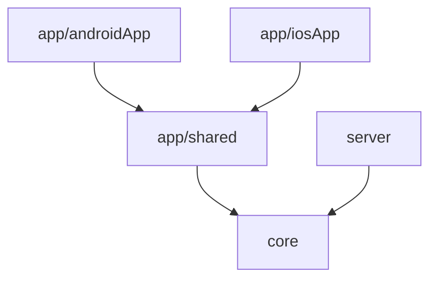

# Be-Fair

Be-Fair is application that allows you to track cost-effectiveness of your waredrobe.

## Key Features (Planned)

- **User account:** Register & Login user account.
- **Track clothes wearing & washing:** Add your clothes and track its usage.
- **Real-time Sync:** All data is synced across devices via a centralized backend.

## Tech Stack

- Kotlin Multiplatform
- Backend: [Ktor](https://ktor.io/) server (Netty)
- Mobile UI: [Compose Multiplatform](https://www.jetbrains.com/lp/compose-multiplatform/) (Material 3), Navigation 3
- DI: Manual container (no framework)

## Project Structure

- `app/androidApp`: The entry point for the Android application.
- `app/iosApp`: The entry point for the iOS application.
- `app/shared`: Shared UI, navigation, networking, and mobile domain/data logic using Compose Multiplatform.
- `core`: The wire contract between the apps and the server — `@Serializable` DTOs, option enums, pure domain logic, and shared constants. No networking, no platform code.
- `server`: The Ktor backend server.



## Software Architecture
Follow [Clean Architecture](https://blog.cleancoder.com/uncle-bob/2012/08/13/the-clean-architecture.html) rules.
The design component definition follows [atomic design](https://atomicdesign.bradfrost.com/chapter-2/)

```
app/shared/
├── ui/           # Presentation — Compose screens and components (atomic design)
│   ├── atoms/        # Basic reusable UI pieces (Button, Colors, Theme, Title). Unique components.
│   ├── molecules/    # Simple groups of atoms functioning together as a unit.
│   ├── organisms/    # Complex components composed of molecules, atoms, and/or other organisms.
│   ├── templates/    # Page-level layouts that place components and define content structure (e.g. LoginTemplate).
│   └── screens/      # Specific instances of templates filled with real data (e.g. LoginScreen, HomeScreen).
├── domain/       # Use-cases (business logic)
├── data/         # Repositories and controllers
├── model/        # Model classes shared across layers
├── di/           # Dependency injection containers
└── util/         # Tools and helpers
```

## Getting Started

### Prerequisites

- Android Studio (for Android and KMP)
- Xcode (for iOS development)
- JDK 17 or higher
- Docker (for the backend database and the server test suite)

### Running the App

#### Android
1. Open the project in Android Studio.
2. Select the `app.androidApp` run configuration.
3. Click "Run".

OR run shell command:

```shell
./gradlew :app:androidApp:assembleDebug
```

#### iOS
1. Open `app/iosApp/iosApp.xcodeproj` in Xcode.
2. Select a simulator or physical device.
3. Click "Run".

#### Build modes

The mobile app has two modes. Each host reports its mode once at startup, and the shared code
derives the API base URL and logging from it. A missing or unrecognized mode is treated as PROD.

| | DEV | PROD |
|---|---|---|
| Android | `debug` variant | `release` variant |
| iOS | `Debug` configuration | `Release` configuration |
| API base URL | `http://10.0.2.2:8080` (Android emulator), `http://localhost:8080` (iOS simulator) | the production URL set at build time (HTTPS only) |
| Logging | Application logs and HTTP request/response headers; `Authorization` values are redacted | None |
| Android minification | Off | R8 shrinking and resource shrinking on |

**Run DEV.** On Android, run the `debug` variant: `./gradlew :app:androidApp:assembleDebug`, or
the `app.androidApp` run configuration. On iOS, run from Xcode with the `Debug` configuration
(the default for Run). Neither needs a production URL. Start the backend first (see
[Backend](#backend)).

**Build release.** Release builds need the production URL, which is baked into the app at build
time. Pass it as a Gradle property or an environment variable:

```shell
./gradlew :app:androidApp:assembleRelease -Pbefair.productionUrl=https://api.example.com
# or
BEFAIR_PRODUCTION_URL=https://api.example.com ./gradlew :app:androidApp:assembleRelease
```

- If both are set, the Gradle property wins.
- The URL must start with `https://`. The build fails if it is missing or uses another scheme.
- A trailing `/` is removed.
- iOS `Release` builds in Xcode get the URL through the same Gradle resolution: Xcode runs
  `embedAndSignAppleFrameworkForXcode`, which reads `BEFAIR_PRODUCTION_URL` from the environment
  (or `befair.productionUrl` from `~/.gradle/gradle.properties`). The build fails if neither is
  valid.

**R8 mapping file.** Release builds are minified. To deobfuscate crash stack traces, keep the
mapping file from each released build:

```
app/androidApp/build/outputs/mapping/release/mapping.txt
```

#### Backend

The server needs a PostgreSQL database. The quickest way to get the whole stack up is Docker:

```shell
docker compose up --build
```

That starts PostgreSQL and the server together, applies the Flyway migrations on startup, and
serves `http://localhost:8080`. Database files live in the `befair-db` named volume, so they
survive `docker compose down` and image rebuilds.

To run the server from Gradle instead, start just the database and leave it listening on
`localhost:5432`, which is what the connection defaults point at:

```shell
docker compose up -d db
./gradlew :server:run
```

Connection settings are read from the environment, defaulting to local development values:

| Variable | Default |
|---|---|
| `DATABASE_URL` | `jdbc:postgresql://localhost:5432/befair` |
| `DATABASE_USER` | `befair` |
| `DATABASE_PASSWORD` | `befair` |
| `DATABASE_MAX_POOL_SIZE` | `10` |

For Gradle runs, override these settings for any deployment reachable from outside your machine.
For Docker Compose, set `POSTGRES_DB`, `POSTGRES_USER`, and `POSTGRES_PASSWORD` in an untracked
`.env` file instead; Compose derives `DATABASE_URL`, `DATABASE_USER`, and `DATABASE_PASSWORD`
from them. `DATABASE_MAX_POOL_SIZE` is used directly in both workflows. Schema changes
go in `server/src/main/resources/db/migration` as new `V<n>__*.sql` files — see
[`server/AGENTS.md`](./server/AGENTS.md).

#### Testing
```shell
# All tests
./gradlew test

# Module tests
./gradlew :app:shared:testDebugUnitTest
./gradlew :server:test
./gradlew :core:testDebugUnitTest
```

`:server:test` starts a real PostgreSQL container through Testcontainers, so **Docker must be
running** for the server suite.

## Development Rules

For AI agents and developers:
- [AGENTS.md](/AGENTS.md) — architecture, module ownership, boundaries, and safe-edit guidelines.
- [DESIGN.md](app/shared/src/commonMain/kotlin/dev/jakubzika/befair/ui/DESIGN.md) — design system tokens (colors, typography, spacing) and component patterns.
- [PRD.md](./PRD.md) — product requirements and feature scope.
