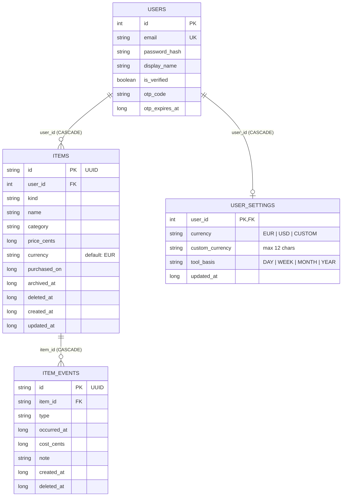

# AGENTS.md — server module

Scoped guidance for the `server` module.
Read the root [`AGENTS.md`](../AGENTS.md) first for project-wide rules.

## Purpose

`server` is the **Ktor/Netty JVM backend**. It depends on `core` for shared logic and models.
Server-only code lives here; anything shared with mobile goes in `core`.

## Package Layout

```
server/src/
  main/kotlin/dev/jakubzika/befair/
    Application.kt    ← entry point (main) + Application.module()
  test/kotlin/dev/jakubzika/befair/
    ApplicationTest.kt
```

## Entry Point & Routing

`Application.kt` contains two things:
- `fun main()` — starts the embedded Netty server on `SERVER_PORT` (from `core/Constants.kt`).
- `fun Application.module()` — installs plugins and registers routes.

Keep `module()` readable: extract large route groups into dedicated extension functions.

```kotlin
// Application.kt
fun Application.module() {
    configureRouting()
    // configureSerialization()
    // configureAuth()
}

// Routing.kt (new file, if needed)
fun Application.configureRouting() {
    routing {
        get("/") { … }
        route("/api/v1") {
            profileRoutes()
        }
    }
}
```

## Adding a Route

1. Add the route inside the appropriate `routing { }` block, or in a new `fun Application.configure<Feature>()` extension.
2. Define `@Serializable` response/request data classes in the same file or a dedicated `model/` package.
3. Install `ContentNegotiation` with `json()` if returning JSON (add `ktor-server-content-negotiation` to `gradle/libs.versions.toml` when first needed).
4. Write a `testApplication` test (see Testing section below).

## Database (Exposed + PostgreSQL)

The server runs on PostgreSQL through a HikariCP pool. `exposed-core`, `exposed-jdbc`,
`postgresql`, and `hikari` are wired in `server/build.gradle.kts`.

`DatabaseFactory.init()` builds the pool and is **idempotent** — the first call connects and
later calls return the same `Database`. Never bypass it with your own `Database.connect`, or
the process ends up with one pool per caller.

Connection settings come from the environment via `DatabaseConfig.fromEnv()`, defaulting to a
local database so `./gradlew :server:run` works with no setup:

| Variable | Default |
|---|---|
| `DATABASE_URL` | `jdbc:postgresql://localhost:5432/befair` |
| `DATABASE_USER` | `befair` |
| `DATABASE_PASSWORD` | `befair` |
| `DATABASE_MAX_POOL_SIZE` | `10` |

Conventions when using Exposed:
- Define table objects as `object MyTable : Table("my_table") { … }` in a `db/` package.
- Wrap all DB access in `transaction { … }` blocks.
- Keep table definitions dialect-neutral; let Exposed generate the SQL (`upsert` becomes
  `ON CONFLICT` on Postgres) rather than writing raw statements.

⚠️ **Never recover from a failed statement inside the same transaction.** PostgreSQL aborts
the whole transaction when a statement fails and refuses every later command with `25P02`, so
"insert, catch the constraint violation, then query the existing row" does not work — the
recovery query fails too. Let the database resolve the conflict in one statement instead:
`insertIgnore` for idempotent inserts (see `ItemRepository.create`), `upsert` for
replace-or-create (see `UserSettingsRepository.save`).

### Schema migrations (Flyway)

The schema is owned by versioned SQL in `server/src/main/resources/db/migration`, applied by
Flyway on startup from `DatabaseFactory`. Exposed no longer creates tables — `SchemaUtils` is
not called anywhere, so **adding a table object is not enough**.

To change the schema:

1. Add `V<n>__<description>.sql` in `db/migration`, numbered one above the highest existing
   version. Use `snake_case` table and column names matching the Exposed `Table("…")` names.
2. Add or update the matching Exposed `object … : Table` so the Kotlin side agrees.
3. Run `./gradlew :server:test` — the Testcontainers database is created from these
   migrations, so a mismatch between SQL and table objects fails the suite.

**Never edit an applied migration.** Flyway checksums each file and refuses to start if one
changes; correct a mistake with a new version instead.

### Running tests

`:server:test` starts a real PostgreSQL container via Testcontainers (`TestDatabase`), so a
**running Docker daemon is required**. Test classes call `TestDatabase.ensureReady()` in an
`init` block; add that to any new test class that touches the database. The suite shares one
database and isolates cases with unique emails and generated ids.

**Testcontainers must stay on 2.x.** The 1.x line requests Docker API v1.32, and Docker
Engine 29 raised its minimum to v1.40 — it rejects older clients with an HTTP 400 that
Testcontainers reports as the much less helpful "Could not find a valid Docker environment".
2.0.2 moved the default to v1.44. Note that module coordinates gained a `testcontainers-`
prefix in 2.x (`org.testcontainers:testcontainers-postgresql`), and `PostgreSQLContainer`
moved to `org.testcontainers.postgresql` and is no longer self-generic.

### Database Schema



**Key Design Notes:**

- **users.id** auto-increments; used as FK in items and (indirectly) item_events.
- **items.id** is a client-generated UUID string (36 chars) to prevent duplicates on retried creates after flaky networks. All FKs from item_events cascade on delete.
- **item_events** uses a single table with a `type` discriminator (wear/wash/use/repair/etc.) to calculate cost-per-use and cost-per-month without per-kind counter columns on items.
- **user_settings** has at most one row per user; `GET /api/settings` returns defaults when none exists and `PUT /api/settings` replaces the whole set (upsert). The DTO and option enums live in `core` (`SettingsModels.kt`).
- **Soft deletes:** items and item_events have `deleted_at` columns; queries should filter `WHERE deleted_at IS NULL` when appropriate.
- **Indices:** `items(user_id)` enables fast per-user queries; `item_events(item_id, occurred_at)` enables efficient cost calculations and event history lookups.

## Testing

Use `testApplication { … }` from `ktor-server-test-host`.

```kotlin
@Test
fun testMyEndpoint() = testApplication {
    application { module() }
    val response = client.get("/api/v1/my-endpoint")
    assertEquals(HttpStatusCode.OK, response.status)
}
```

```shell
# Run all server tests
./gradlew :server:test

# Run the server locally
./gradlew :server:run
# → http://0.0.0.0:8080
```

## Dependencies

Add all server dependencies via `gradle/libs.versions.toml`.
Never hard-code version strings in `server/build.gradle.kts`.
Use the `ktor-*` library aliases already defined in the version catalog.
